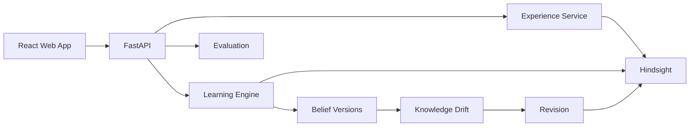

# MIRRORLINE architecture

## Separation of concerns

Hindsight is the persistent experiential memory layer.

The learning engine is responsible for:

- evidence aggregation
- deterministic belief scoring
- contradiction analysis
- context matching
- drift detection
- belief versioning

The LLM, when connected, is responsible for semantic extraction and
explanation rather than being the source of truth for numeric evidence scores.
